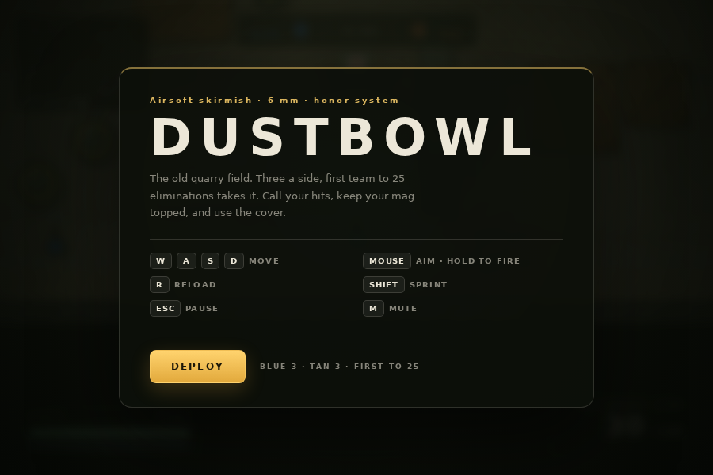
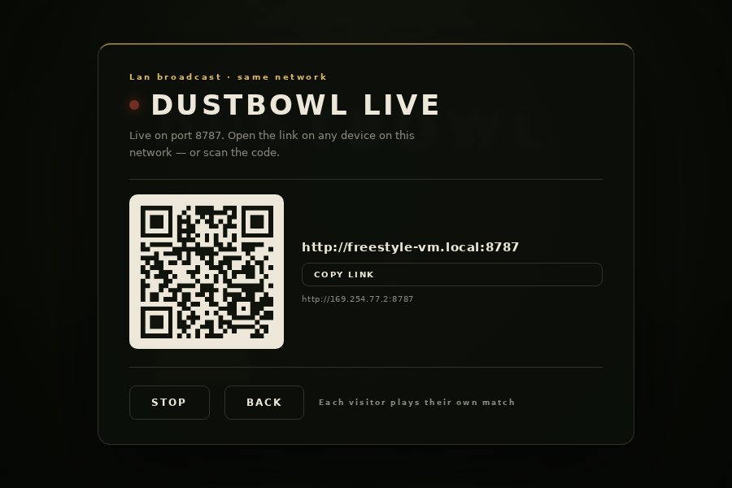
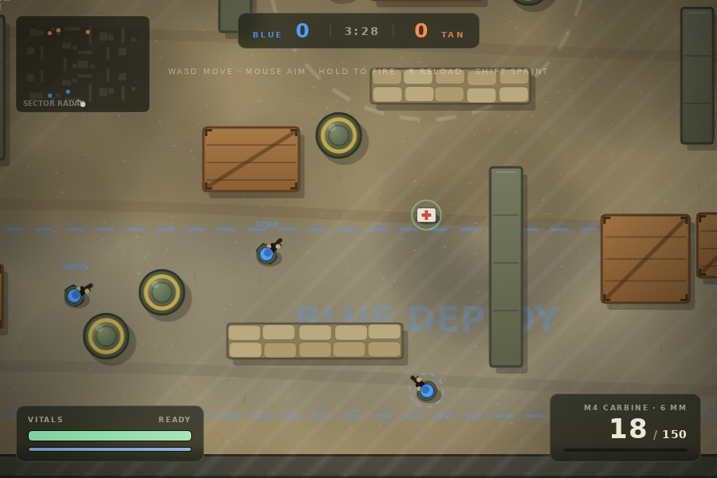

# DUSTBOWL

A top-down airsoft skirmish. Fight bots in a dusty scrapyard arena — or host a match over your local network so anyone on the same Wi-Fi can play in their browser.



## Download the app

Grab a build from the [v1.0.0 release](https://github.com/Isaiah4775/dustbowl/releases/tag/v1.0.0):

| Your computer | File to download |
| --- | --- |
| Linux (x64) | [`DUSTBOWL-1.0.0.AppImage`](https://github.com/Isaiah4775/dustbowl/releases/download/v1.0.0/DUSTBOWL-1.0.0.AppImage) |
| Mac with Apple Silicon (M1/M2/M3/M4) | [`DUSTBOWL-1.0.0-mac-arm64.zip`](https://github.com/Isaiah4775/dustbowl/releases/download/v1.0.0/DUSTBOWL-1.0.0-mac-arm64.zip) |
| Mac with an Intel chip | [`DUSTBOWL-1.0.0-mac-x64.zip`](https://github.com/Isaiah4775/dustbowl/releases/download/v1.0.0/DUSTBOWL-1.0.0-mac-x64.zip) |

Not sure which Mac you have? Open the Apple menu → **About This Mac**; the Chip line says either "Apple M…" or "Intel".

### Linux

Make the AppImage executable and run it:

```bash
chmod +x DUSTBOWL-1.0.0.AppImage
./DUSTBOWL-1.0.0.AppImage
```

If it fails to start because of sandboxing, launch it with `--no-sandbox`.

### macOS — the build is unsigned, so Gatekeeper will block it

These builds are not signed with an Apple Developer certificate or notarized, so macOS will refuse the first launch with a message like *"DUSTBOWL.app is damaged and can't be opened"* or *"Apple cannot check it for malicious software"*. That is Gatekeeper reacting to the missing signature, not a broken download, and right-click → Open is often **not** enough for a completely unsigned app. Clear the quarantine flag instead, which is the reliable fix:

1. Unzip the download to get `DUSTBOWL.app`, then drag it into **Applications**.
2. Open **Terminal** and run:

   ```bash
   xattr -dr com.apple.quarantine /Applications/DUSTBOWL.app
   ```
3. Open DUSTBOWL normally from Applications or Launchpad.

If macOS still complains, try **System Settings → Privacy & Security**, scroll down to the DUSTBOWL line, and click **Open Anyway**. You only need to do this once — after the first successful launch the app opens normally.

If you'd rather avoid the Terminal, use the browser version instead — `node server.js` in this repo, then open http://localhost:3000.

> Signing and notarization are wired up in `.github/workflows/macos-signed.yml`; once a Developer ID certificate is added to the repository secrets, that workflow replaces these zips with signed, notarized builds that open with no warning at all.

## Host a LAN match

The app can serve the game over your local network, so other people on the same Wi-Fi or Ethernet can join from a browser — no installs on their end.

1. Open DUSTBOWL and click **GO LIVE ON LAN** on the start screen. (From inside a match, use the menu **Go Live on LAN…**, or press <kbd>Cmd</kbd>/<kbd>Ctrl</kbd>+<kbd>L</kbd>.)
2. The DUSTBOWL LIVE panel opens with a **QR code** and a link like `http://192.168.1.24:8787`.
3. Others scan the QR code with their phone, or type the link into a browser on any device on the same network.
4. Click **STOP** in the panel when you're done — the server closes and the link stops working.



Each visitor plays their own match against bots — it's a way to hand the game to a room instantly, not a shared server or spectator stream. The host machine needs to stay open and running while others play. If a device can't connect, check that both are on the same network and that your firewall allows incoming connections on port 8787; you can also use **Copy link** to send the address directly.

## Controls

| Action | Keys |
| --- | --- |
| Move | <kbd>W</kbd><kbd>A</kbd><kbd>S</kbd><kbd>D</kbd> or arrow keys |
| Aim / fire | Mouse |
| Reload | <kbd>R</kbd> |
| Deploy / start | <kbd>Enter</kbd> or <kbd>Space</kbd> |
| Pause | <kbd>Esc</kbd> |
| Mute audio | <kbd>M</kbd> |

Reach the target score or outlast the clock to win the match.


